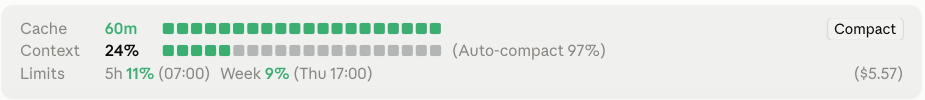

# claude-mods: Claude Code mods

**Mods for [Claude Code](https://code.claude.com): a status band above the prompt with prompt-cache countdown, context fill, usage limits and session cost.**

English | [Deutsch](README.de.md)

If this is useful, a ⭐ on the repo helps others find it.

| Mod | What it does |
|---|---|
| [session-status](session-status) | Band above the prompt: prompt-cache countdown, context fill, usage limits (5-hour and weekly), session cost, Compact button |



## Install

Needs a Claude Code build with mod (function hook) support. Developed against 2.1.295.

**1. In a Claude Code terminal session:**

```
/plugin install session-status --marketplace sphings79/claude-mods
```

Answer `y` to add the marketplace, then pick a scope. **User** scope loads it in every session.

**Or from a shell:**

```sh
claude plugin marketplace add sphings79/claude-mods
claude plugin install session-status@claude-mods
```

No SSH key set up for GitHub? Add the marketplace over HTTPS instead:

```sh
claude plugin marketplace add https://github.com/sphings79/claude-mods.git
claude plugin install session-status@claude-mods
```

**2. Load it:** restart Claude Code or run `/reload-plugins`. The band appears after the first answer of a session.

**Desktop app:** `/plugin install` is not available in the Code tab. Install from a terminal at user scope; the mod then loads in desktop sessions too.

**Update / remove:**

```sh
claude plugin update session-status@claude-mods
claude plugin uninstall session-status@claude-mods
```

## session-status

```
Cache    60m ■■■■■■■■■■■■■■■■■■■■ 184k tokens                  [Compact]
Context  19% ■■■■□□□□□□□□□□□□□□□□ (Auto-compact 97%)
Limits   5h 23% (14:30)  Week 41% (Mon 09:00)               ($1.23)
```

- **Cache**: minutes left on the 1-hour prompt cache since the last answer. The bar shows the time left: green, amber at 20 min, red at 10 min, `expired` when it is gone. Behind the bar: how many tokens the cache holds (read plus written by the last response).
- **Context**: bar by context fill, green, amber from 60 %, red from 80 %.
- **Auto-compact**: the threshold at which Claude Code compacts on its own, in percent of the window.
- **Limits**: usage of the 5-hour and weekly windows with their reset time; a gateway's spend limit too. Colours follow the context thresholds. Shown once the last response reported them.
- **Cost** (bottom right, in parentheses): what the session has cost so far, as `/cost` totals it. On a subscription that is an API-equivalent estimate, not a bill.
- **Compact** (top right): runs `/compact`. Not while an answer is being written.
- **`/session-status`** shows or hides the band.

### Language

Option `language`: `auto` (default; follows Claude Code's `language` setting, then the system locale), `de` or `en`. Set it in `/config`, or in `~/.claude/settings.json`:

```json
{ "pluginConfigs": { "session-status": { "options": { "language": "de" } } } }
```

## Support

Free and MIT licensed. If it saves you tokens or time, you can [buy me a coffee](https://buymeacoffee.com/sphings). More at [sphings-dev.de](https://sphings-dev.de).

## License

MIT
